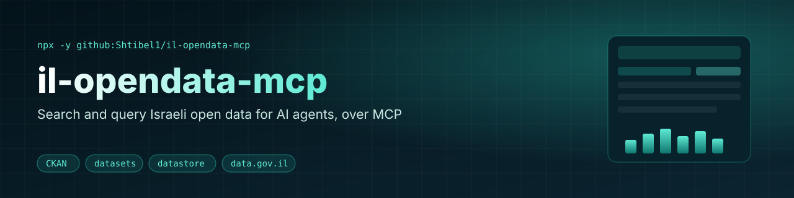
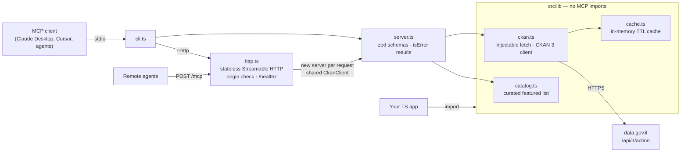

<div align="center">



[](https://github.com/Shtibel1/il-opendata-mcp/actions/workflows/ci.yml)
[](package.json)
[](LICENSE)

[](https://modelcontextprotocol.io)

**Search and query Israeli government open data (data.gov.il) from any MCP client.**

</div>

<p align="center"><a href="#quick-start">Quick start</a> · <a href="#tools">Tools</a> · <a href="#resources">Resources</a> · <a href="#caching">Caching</a> · <a href="#architecture">Architecture</a> · <a href="#roadmap">Roadmap</a></p>

A [Model Context Protocol](https://modelcontextprotocol.io) server that lets AI agents search the official [data.gov.il](https://data.gov.il) catalog and query datastore-backed resources through the public CKAN 3 API — datasets, resources and records, without dumping raw CKAN blobs into the context window.

This is the network / open-data counterpart to [hebrew-il-mcp](https://github.com/Shtibel1/hebrew-il-mcp), which covers local deterministic validators (ID, phone, VAT, IBAN, plates, postal codes, holidays).

## Tools

| Tool | What it does |
| --- | --- |
| `search_datasets` | CKAN `package_search`. Optional free-text `q`, optional `organization` slug (validated, sent as `fq=organization:<slug>`), optional `rows` (default 10, max 50) and `start`. Returns the match count plus a compact dataset list (name, title, truncated notes, organization, tags, resource summaries and how many resources have `datastore_active`). |
| `list_organizations` | CKAN `organization_list` with `all_fields`. Lists the ~60 publishing ministries and authorities sorted by dataset count. Optional `q` matches the slug **or the Hebrew title** (e.g. `תחבורה`), plus `limit` (default 25, max 100) and `offset`. Feed a returned `name` into `search_datasets.organization`. |
| `get_dataset` | CKAN `package_show` by package name or UUID. Returns the same compact metadata plus resources (`id`, `name`, `format`, `datastore_active`, `last_modified`). |
| `describe_resource` | CKAN `datastore_search` with `limit=0` to return field names/types and the total record count. Clear error if the resource has no active datastore. |
| `search_records` | CKAN `datastore_search`. Optional full-text `q`, exact-match `filters`, `fields`, `limit` (default 10, max 100) and `offset`. Returns `total`, `fields` and `records`. |
| `list_featured_datasets` | No network. Optional `category`: `companies`, `vehicles`, `education`, `fuel`, `government` or `all` (default). Returns a curated starting point of well-known datasets — **not a complete index**. Use `search_datasets` for everything else. |

Every tool returns both human-readable JSON text and `structuredContent`. Failures produce an MCP `isError` result instead of crashing the session.

## Resources

Clients that support [MCP resources](https://modelcontextprotocol.io/specification/2025-06-18/server/resources) can attach catalog context directly, without a tool call:

| URI | What it returns |
| --- | --- |
| `opendata://featured` | The curated featured-dataset shortlist with categories. No network. |
| `opendata://organizations` | Every publishing ministry/authority (~60), sorted by dataset count — same shape as `list_organizations`. |
| `opendata://dataset/{name}` | Resource template: compact metadata + resources for one CKAN package, e.g. `opendata://dataset/gsa`. The featured datasets are listed as concrete resources, and dataset names autocomplete. Names are validated before CKAN is called. |

All resources are `application/json`.

Typical flow:

1. `search_datasets` with a query such as `"חברות ממשלתיות"` (or start from `list_featured_datasets`).
2. `get_dataset` with a package name from the results, e.g. `gsa`.
3. `describe_resource` with a resource id where `datastore_active` is true.
4. `search_records` with that resource id, optional `q` / `filters`, and a small `limit`.

## Caching

data.gov.il is slow (a full `organization_list` takes several seconds) and the catalog changes slowly, so successful CKAN GET responses are cached in memory, keyed by the full request URL:

- **Default TTL 5 minutes**; `--cache-ttl <seconds>` or `IL_OPENDATA_CACHE_TTL` changes it, `0` disables caching.
- **Shared across HTTP requests**: the stateless HTTP mode creates a fresh MCP server per request but reuses one `CkanClient`, so every agent hitting the same instance benefits.
- **Concurrent identical requests share one network call**, errors and HTTP failures are never cached, and at most 256 responses are kept (oldest evicted first).
- `list_organizations` filters locally, so every `q` reuses one cached `organization_list` response.

Live on 2026-11-18: reading `opendata://organizations` took ~9.3 s cold and the following `list_organizations` call 4 ms; `get_dataset gsa` went from ~580 ms to 2 ms.

## Why

Agents that work with Israeli companies, vehicles, schools or public registries should query the official catalog instead of guessing URLs or inventing dataset ids. data.gov.il already exposes a documented CKAN API; this server wraps it with pagination caps, truncated notes, compact resource summaries and MCP-safe errors so an agent can search and then drill into datastore rows without flooding its context.

## Quick start

### Claude Desktop / Cursor / any MCP client

```json
{
  "mcpServers": {
    "il-opendata": {
      "command": "npx",
      "args": ["-y", "github:Shtibel1/il-opendata-mcp"]
    }
  }
}
```

Or from a local clone:

```bash
npm install && npm run build
node dist/cli.js   # speaks MCP over stdio
```

### Hosted: Streamable HTTP

Run it as a network service that any remote MCP client (or several agents at once) can share:

```bash
npx -y github:Shtibel1/il-opendata-mcp --http --port 3000
# → il-opendata-mcp listening on http://127.0.0.1:3000/mcp
curl http://127.0.0.1:3000/healthz   # {"status":"ok","name":"il-opendata-mcp","version":"0.5.0"}
```

Then point a client that supports remote servers at it:

```json
{ "mcpServers": { "il-opendata": { "url": "http://127.0.0.1:3000/mcp" } } }
```

| Flag | Env | Default | Notes |
| --- | --- | --- | --- |
| `--http` | | off | Serve [Streamable HTTP](https://modelcontextprotocol.io/specification/2025-06-18/basic/transports#streamable-http) instead of stdio |
| `--port` | `PORT` | `3000` | |
| `--host` | `HOST` | `127.0.0.1` | Binds to loopback by default; use `0.0.0.0` inside a container |
| `--allowed-origin` | `ALLOWED_ORIGINS` | none | Repeatable flag, or a comma-separated env var. Browser requests from any other `Origin` get `403` (DNS-rebinding protection); non-browser clients without `Origin` are always allowed |
| `--cache-ttl` | `IL_OPENDATA_CACHE_TTL` | `300` | Seconds to cache CKAN responses in memory (see [Caching](#caching)); `0` disables. Also applies to stdio mode |

The HTTP mode is **stateless**: every `POST /mcp` gets a fresh server and transport, there are no session ids, and `GET`/`DELETE /mcp` return `405`. That means instances can sit behind any load balancer with no sticky sessions. Bodies over 1 MB get `413`, malformed JSON gets `400`.

### Docker

The image runs the HTTP mode as the unprivileged `node` user, binds `0.0.0.0:3000`, and ships a `HEALTHCHECK` against `/healthz`:

```bash
docker build -t il-opendata-mcp .
docker run --rm -p 3000:3000 -e ALLOWED_ORIGINS=https://app.example il-opendata-mcp
```

CI builds the image on every push and smoke-tests it: health check, a real `tools/list` call, the origin guard, and the non-root user.

### One-click deploy

[](https://render.com/deploy?repo=https://github.com/Shtibel1/il-opendata-mcp)

The [`render.yaml`](render.yaml) blueprint builds the Dockerfile, wires `/healthz` as the health check, and prompts for `ALLOWED_ORIGINS`. Any container host (Fly.io, Railway, Cloud Run, ECS) works the same way: run the image and expose port 3000.

Programmatic use:

```ts
import { startHttpServer } from "il-opendata-mcp";

const { url, close } = await startHttpServer({ port: 0, allowedOrigins: ["https://app.example"] });
```

### As a library

```ts
import { CkanClient, listFeaturedDatasets } from "il-opendata-mcp";

const ckan = new CkanClient({ cacheTtlMs: 60_000 }); // optional; default 5 min, 0 disables
const { count, datasets } = await ckan.searchDatasets({ q: "חינוך" });
const dataset = await ckan.getDataset("gsa");
const resource = dataset.resources.find((item) => item.datastore_active);
if (resource) {
  const schema = await ckan.describeResource(resource.id);
  const rows = await ckan.searchRecords({ resource_id: resource.id, limit: 5 });
}

listFeaturedDatasets("companies"); // curated names such as ica_companies, gsa, …
```

## Architecture



### Layout

```
src/
  lib/ckan.ts      injectable-fetch CKAN client (no MCP imports)
  lib/catalog.ts   curated featured-dataset list (static, verified names only)
  lib/cache.ts     in-memory TTL cache (promise sharing, no cached errors, bounded size)
  server.ts        MCP tool + resource wiring (zod schemas)
  version.ts       single source of the version (handshake, User-Agent, /healthz)
  http.ts          stateless Streamable HTTP transport (node:http, no framework)
  cli.ts           entry: stdio by default, --http for hosted mode
  index.ts         public exports
test/
  ckan.test.ts     URL building, parsing, errors, pagination caps
  catalog.test.ts  category filters
  cache.test.ts    TTL cache + CkanClient caching (expiry, keys, in-flight sharing, errors, disable)
  server.test.ts   end-to-end tests through a real MCP client (tools, resources, completion; in-memory transport, mocked fetch)
  http.test.ts     real HTTP server on an ephemeral port: client round-trip, statelessness, shared cache, health, 400/403/404/405
```

- **Pure core, thin adapter.** Networking and mapping live in `src/lib` with no MCP dependency, so the client is reusable as a plain TypeScript library.
- **Compact payloads.** Long notes are truncated (~500 characters) and raw CKAN blobs are mapped down to the fields agents actually need.
- **Pagination caps.** Dataset search is limited to 50 rows; datastore queries are limited to 100 records.
- **Curated starting point.** `list_featured_datasets` is a verified shortlist (companies, vehicles, education, fuel, government), not a complete catalog.

## Featured datasets

These CKAN package names were verified against the live catalog on 2026-11-08:

| Category | Package name | Title |
| --- | --- | --- |
| companies | `ica_companies` | מאגר חברות - רשם החברות |
| companies | `ica_partnerships` | מאגר שותפויות - רשם החברות |
| companies | `ica-changes` | פרטי שינויים בחברות ושותפויות |
| companies / government | `gsa` | רשימת חברות ממשלתיות ודירקטורים מכהנים |
| companies | `pinkashakablanim` | פנקס הקבלנים הרשומים |
| vehicles | `private-and-commercial-vehicles` | מספרי רישוי של כלי רכב פרטיים ומסחריים |
| vehicles | `shinui_mivne` | היסטוריית כלי רכב פרטיים |
| education | `mosdot_edu` | מוסדות חינוך |
| education | `mosdot` | מאפייני מוסדות חינוך בפיקוח משרד החינוך |
| fuel | `fuelstationbynumber` | מאגר תחנות הדלק |
| fuel | `gas-stations-br7` | תחנות דלק |

Use `search_datasets` to discover anything that is not on this list.

## Development

```bash
npm test          # vitest (mocked fetch — no network required)
npm run typecheck
npm run build
```

## Attribution

This is an unofficial client. Data comes from [data.gov.il](https://data.gov.il) and its original publishers under their terms. This project does not claim any government affiliation.

## Roadmap

- [ ] Publish to npm so `npx il-opendata-mcp` works without the GitHub shorthand
- [x] Hosted (Streamable HTTP) transport option (v0.2.0)
- [x] Dockerfile and one-click deploy for the HTTP mode (v0.3.0)
- [x] Browse by publisher: `list_organizations` + `search_datasets.organization` filter (v0.4.0)
- [x] In-memory response cache (`--cache-ttl`) shared across HTTP requests, and MCP resources `opendata://featured`, `opendata://organizations`, `opendata://dataset/{name}` (v0.5.0)
- [ ] Structured datastore filters beyond exact match (ranges via `datastore_search_sql`)

## Contributing

Issues and PRs are welcome. Keep CKAN mapping in `src/lib` with unit tests, and add an end-to-end case in `test/server.test.ts` for new tools. Please do not invent dataset ids — verify names against the live catalog.

## License

[MIT](LICENSE) © Nadav Shtibel
