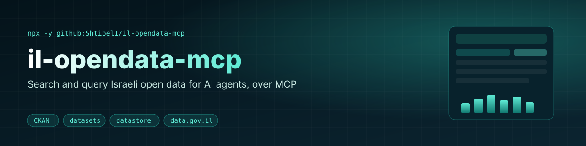
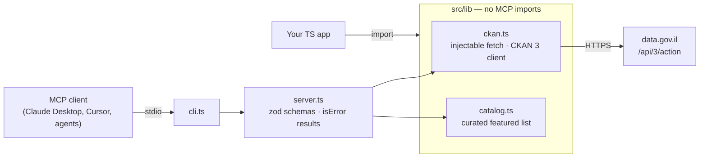

<div align="center">



[](https://github.com/Shtibel1/il-opendata-mcp/actions/workflows/ci.yml)
[](package.json)
[](LICENSE)

[](https://modelcontextprotocol.io)

**Search and query Israeli government open data (data.gov.il) from any MCP client.**

</div>

<p align="center"><a href="#quick-start">Quick start</a> · <a href="#tools">Tools</a> · <a href="#architecture">Architecture</a> · <a href="#roadmap">Roadmap</a></p>

A [Model Context Protocol](https://modelcontextprotocol.io) server that lets AI agents search the official [data.gov.il](https://data.gov.il) catalog and query datastore-backed resources through the public CKAN 3 API — datasets, resources and records, without dumping raw CKAN blobs into the context window.

This is the network / open-data counterpart to [hebrew-il-mcp](https://github.com/Shtibel1/hebrew-il-mcp), which covers local deterministic validators (ID, phone, VAT, IBAN, plates, postal codes, holidays).

## Tools

| Tool | What it does |
| --- | --- |
| `search_datasets` | CKAN `package_search`. Free-text `q`, optional `rows` (default 10, max 50) and `start`. Returns the match count plus a compact dataset list (name, title, truncated notes, organization, tags, resource summaries and how many resources have `datastore_active`). |
| `get_dataset` | CKAN `package_show` by package name or UUID. Returns the same compact metadata plus resources (`id`, `name`, `format`, `datastore_active`, `last_modified`). |
| `describe_resource` | CKAN `datastore_search` with `limit=0` to return field names/types and the total record count. Clear error if the resource has no active datastore. |
| `search_records` | CKAN `datastore_search`. Optional full-text `q`, exact-match `filters`, `fields`, `limit` (default 10, max 100) and `offset`. Returns `total`, `fields` and `records`. |
| `list_featured_datasets` | No network. Optional `category`: `companies`, `vehicles`, `education`, `fuel`, `government` or `all` (default). Returns a curated starting point of well-known datasets — **not a complete index**. Use `search_datasets` for everything else. |

Every tool returns both human-readable JSON text and `structuredContent`. Failures produce an MCP `isError` result instead of crashing the session.

Typical flow:

1. `search_datasets` with a query such as `"חברות ממשלתיות"` (or start from `list_featured_datasets`).
2. `get_dataset` with a package name from the results, e.g. `gsa`.
3. `describe_resource` with a resource id where `datastore_active` is true.
4. `search_records` with that resource id, optional `q` / `filters`, and a small `limit`.

## Why

Agents that work with Israeli companies, vehicles, schools or public registries should query the official catalog instead of guessing URLs or inventing dataset ids. data.gov.il already exposes a documented CKAN API; this server wraps it with pagination caps, truncated notes, compact resource summaries and MCP-safe errors so an agent can search and then drill into datastore rows without flooding its context.

## Quick start

### Claude Desktop / Cursor / any MCP client

```json
{
  "mcpServers": {
    "il-opendata": {
      "command": "npx",
      "args": ["-y", "github:Shtibel1/il-opendata-mcp"]
    }
  }
}
```

Or from a local clone:

```bash
npm install && npm run build
node dist/cli.js   # speaks MCP over stdio
```

### As a library

```ts
import { CkanClient, listFeaturedDatasets } from "il-opendata-mcp";

const ckan = new CkanClient();
const { count, datasets } = await ckan.searchDatasets({ q: "חינוך" });
const dataset = await ckan.getDataset("gsa");
const resource = dataset.resources.find((item) => item.datastore_active);
if (resource) {
  const schema = await ckan.describeResource(resource.id);
  const rows = await ckan.searchRecords({ resource_id: resource.id, limit: 5 });
}

listFeaturedDatasets("companies"); // curated names such as ica_companies, gsa, …
```

## Architecture



### Layout

```
src/
  lib/ckan.ts      injectable-fetch CKAN client (no MCP imports)
  lib/catalog.ts   curated featured-dataset list (static, verified names only)
  server.ts        MCP tool wiring (zod schemas)
  cli.ts           stdio transport entry
  index.ts         public exports
test/
  ckan.test.ts     URL building, parsing, errors, pagination caps
  catalog.test.ts  category filters
  server.test.ts   end-to-end tests through a real MCP client (in-memory transport, mocked fetch)
```

- **Pure core, thin adapter.** Networking and mapping live in `src/lib` with no MCP dependency, so the client is reusable as a plain TypeScript library.
- **Compact payloads.** Long notes are truncated (~500 characters) and raw CKAN blobs are mapped down to the fields agents actually need.
- **Pagination caps.** Dataset search is limited to 50 rows; datastore queries are limited to 100 records.
- **Curated starting point.** `list_featured_datasets` is a verified shortlist (companies, vehicles, education, fuel, government), not a complete catalog.

## Featured datasets

These CKAN package names were verified against the live catalog on 2026-11-08:

| Category | Package name | Title |
| --- | --- | --- |
| companies | `ica_companies` | מאגר חברות - רשם החברות |
| companies | `ica_partnerships` | מאגר שותפויות - רשם החברות |
| companies | `ica-changes` | פרטי שינויים בחברות ושותפויות |
| companies / government | `gsa` | רשימת חברות ממשלתיות ודירקטורים מכהנים |
| companies | `pinkashakablanim` | פנקס הקבלנים הרשומים |
| vehicles | `private-and-commercial-vehicles` | מספרי רישוי של כלי רכב פרטיים ומסחריים |
| vehicles | `shinui_mivne` | היסטוריית כלי רכב פרטיים |
| education | `mosdot_edu` | מוסדות חינוך |
| education | `mosdot` | מאפייני מוסדות חינוך בפיקוח משרד החינוך |
| fuel | `fuelstationbynumber` | מאגר תחנות הדלק |
| fuel | `gas-stations-br7` | תחנות דלק |

Use `search_datasets` to discover anything that is not on this list.

## Development

```bash
npm test          # vitest (mocked fetch — no network required)
npm run typecheck
npm run build
```

## Attribution

This is an unofficial client. Data comes from [data.gov.il](https://data.gov.il) and its original publishers under their terms. This project does not claim any government affiliation.

## Roadmap

- [ ] Publish to npm so `npx il-opendata-mcp` works without the GitHub shorthand
- [ ] Hosted (Streamable HTTP) transport option

## Contributing

Issues and PRs are welcome. Keep CKAN mapping in `src/lib` with unit tests, and add an end-to-end case in `test/server.test.ts` for new tools. Please do not invent dataset ids — verify names against the live catalog.

## License

[MIT](LICENSE) © Nadav Shtibel
